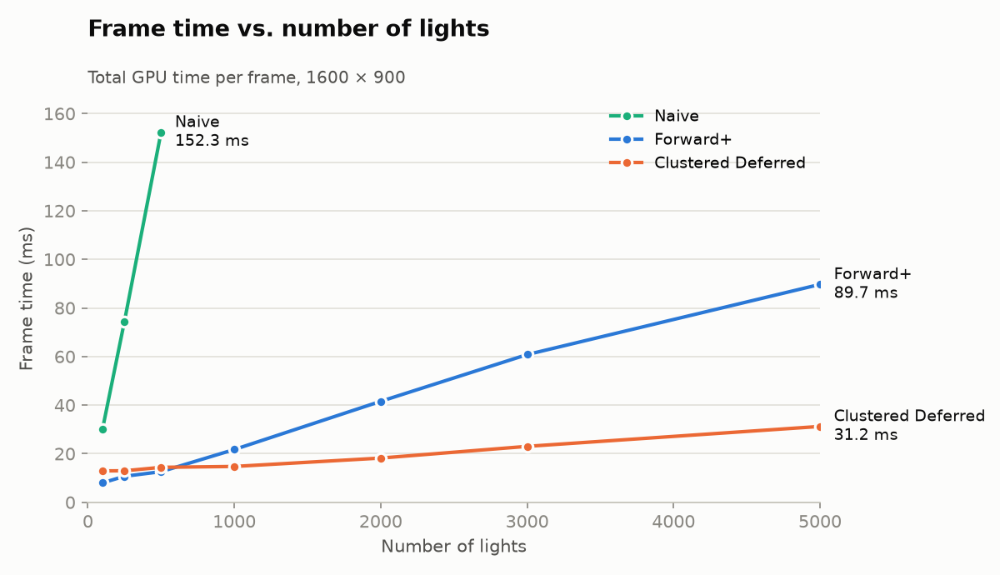
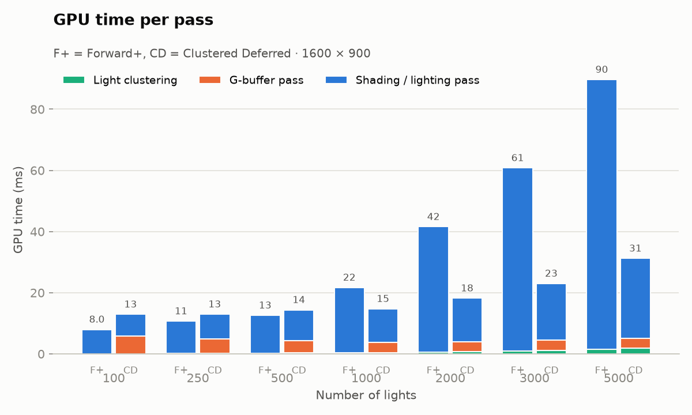
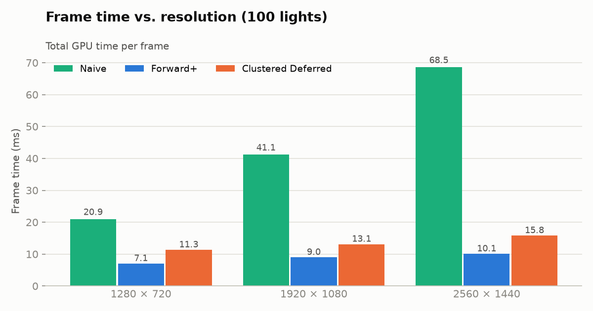
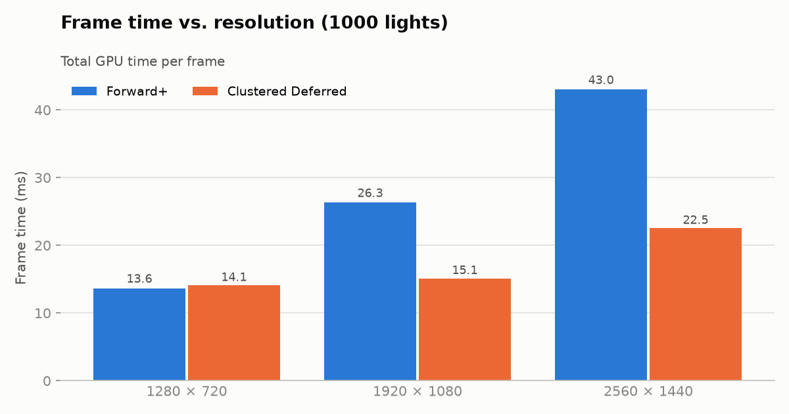
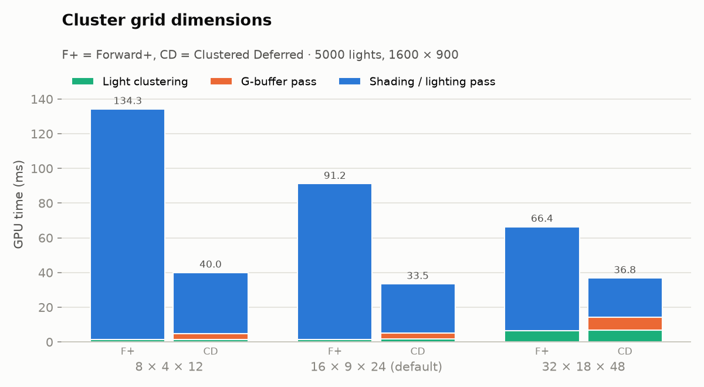
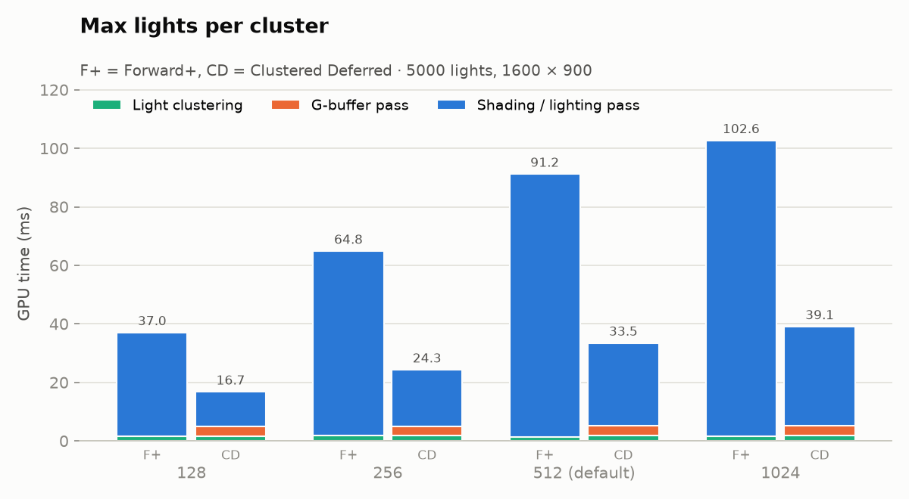
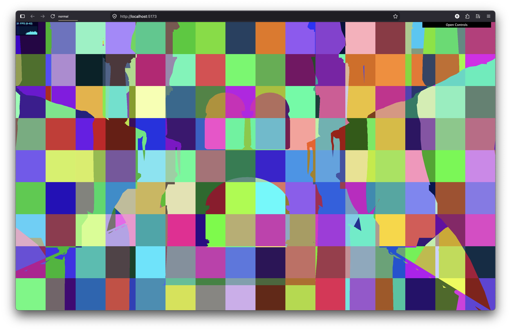
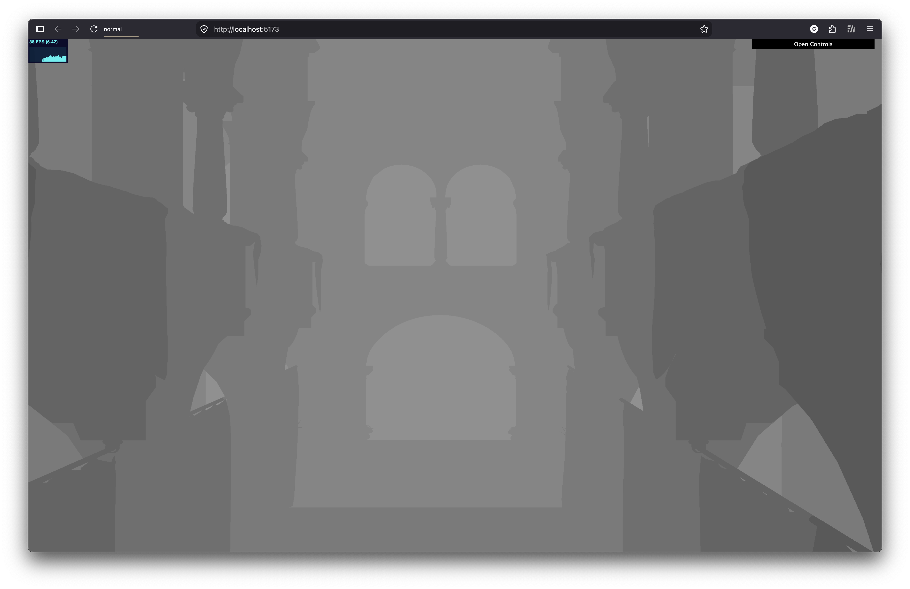
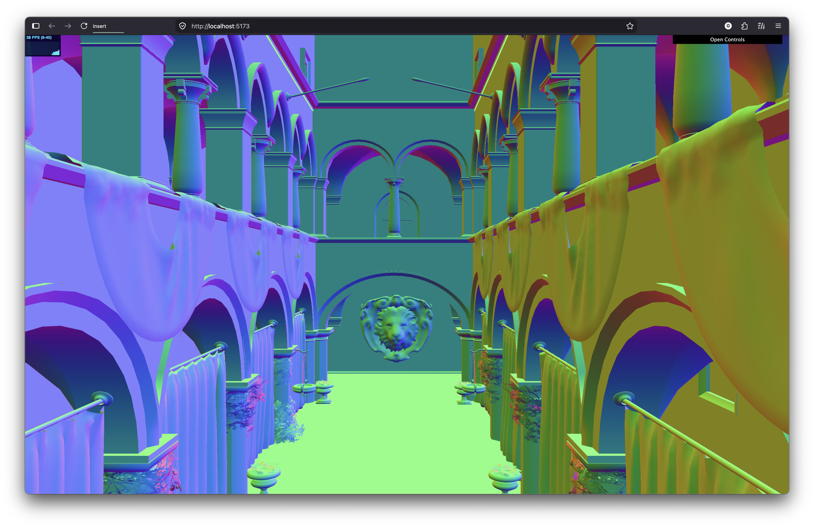
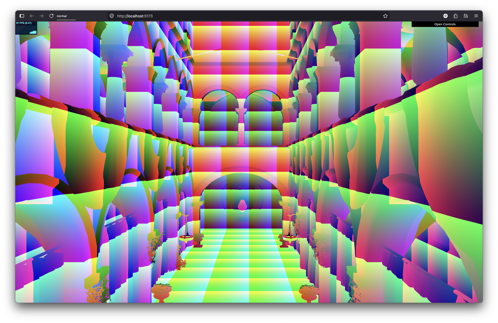

WebGPU Forward+ and Clustered Deferred Shading
======================

**University of Pennsylvania, CIS 565: GPU Programming and Architecture, Project 4**

* Gordon Kim
* Tested on: **Google Chrome 155.0.8059.80** on
  macOS 15.0.1, Apple M2 16GB (unified memory, integrated GPU) (personal computer)

https://github.com/user-attachments/assets/a795f90a-f968-4de1-8028-011b90c898e7

### Live Demo

https://rlarkdfus.github.io/Project4-WebGPU-Forward-Plus-and-Clustered-Deferred

## Overview

This project renders the Sponza scene with up to 5000 moving point lights, and compares three renderers that can be switched between in the GUI.

Features Implemented:
- Naive: every fragment loops over every light
- Forward+: a compute pass bins lights into a 3D grid of clusters over the view frustum, and each fragment only loops over the lights in its cluster
- Clustered Deferred: same clustering as Forward+, but the scene is first written to a G-buffer and lighting is done once per pixel in a fullscreen pass

## Implementation

- Naive: the camera writes its view-projection matrix to a uniform buffer every frame, which gets bound along with the light buffer.
- Light clustering: the frustum is split into 16 x 9 x 24 clusters. Depth slices are exponential, so clusters close to the camera are thinner. Each compute thread handles one cluster, builds its view-space AABB, and tests every light (sphere with radius 2) against it, storing up to 512 light indices.
- Forward+: each fragment figures out its cluster from its screen position and view-space depth, then only shades with the lights in that cluster.
- Clustered Deferred: the G-buffer pass writes position (`rgba32float`), albedo (`rgba8unorm`) and normal (`rgba16float`). The fullscreen pass reads these back and does the same cluster lookup and light loop as Forward+.

## Performance Analysis

All timings are GPU time per frame in ms, measured with WebGPU timestamp queries at 1600 x 900 from the default camera position. F+ = Forward+, CD = Clustered Deferred.

### 1. Number of lights

| # Lights | Naive | Forward+ | Clustered Deferred |
|---:|---:|---:|---:|
| 100 | 30.06 | 8.00 | 12.93 |
| 250 | 74.45 | 10.71 | 12.96 |
| 500 | 152.29 | 12.60 | 14.39 |
| 1000 | — | 21.71 | 14.75 |
| 2000 | — | 41.56 | 18.20 |
| 3000 | — | 60.79 | 23.02 |
| 5000 | — | 89.68 | 31.22 |

Naive goes up by ~0.3ms per light, so I stopped measuring it after 500 lights since it was too slow.

Per-pass breakdown:

| # Lights | F+ clustering | F+ shading | CD clustering | CD G-buffer | CD lighting |
|---:|---:|---:|---:|---:|---:|
| 100 | 0.08 | 7.92 | 0.09 | 5.68 | 7.16 |
| 250 | 0.13 | 10.58 | 0.18 | 4.75 | 8.03 |
| 500 | 0.15 | 12.45 | 0.30 | 4.01 | 10.08 |
| 1000 | 0.30 | 21.41 | 0.43 | 3.41 | 10.91 |
| 2000 | 0.63 | 40.92 | 0.74 | 3.27 | 14.19 |
| 3000 | 0.95 | 59.84 | 1.14 | 3.36 | 18.52 |
| 5000 | 1.44 | 88.25 | 1.81 | 3.36 | 26.05 |

### 2. Resolution

| Resolution | Naive | Forward+ | Clustered Deferred | CD G-buffer pass |
|---|---:|---:|---:|---:|
| 1280 × 720 | 20.93 | 7.07 | 11.31 | 5.18 |
| 1920 × 1080 | 41.15 | 9.01 | 13.08 | 5.62 |
| 2560 × 1440 | 68.54 | 10.10 | 15.77 | 6.38 |

| Resolution | Forward+ | Clustered Deferred | CD G-buffer pass |
|---|---:|---:|---:|
| 1280 × 720 | 13.65 | 14.09 | 3.69 |
| 1920 × 1080 | 26.30 | 15.12 | 3.80 |
| 2560 × 1440 | 42.99 | 22.53 | 4.55 |

### 3. Forward+ vs. Clustered Deferred

#### **Q: Is one of them faster?**

It depends on the light count. Forward+ is faster up to around 500 lights (8.0ms vs. 12.9ms at 100 lights). Past ~600 lights Clustered Deferred becomes faster, and the gap keeps growing after that, ending up ~2.9x faster at 5000 lights (31.2ms vs. 89.7ms).

#### **Q: Is one of them better at certain types of workloads?**

Forward+ is better when there aren't many lights. Clustered Deferred is better with lots of lights, lots of overdraw, and higher resolutions. At 1000 lights, going from 720p to 1440p makes Forward+ 3.2x slower, but Clustered Deferred only gets 1.6x slower.

#### **Q: What are the benefits and tradeoffs of using one over the other?**

| | Forward+ | Clustered Deferred |
|---|---|---|
| Benefits | No G-buffer, so less memory and bandwidth. Supports per-material shaders, transparency and MSAA. | Each pixel is shaded once, regardless of overdraw. Scales best with lights and resolution. |
| Tradeoffs | Hidden fragments get shaded too, so cost grows with overdraw × lights. | Fixed G-buffer cost every frame. One lighting model. Transparency and MSAA are hard. |

#### **Q: What causes these differences?**

The main reason is overdraw. Forward+ runs the full light loop on every fragment that passes the depth test at the time it's drawn, even if something closer gets drawn over it later. Clustered Deferred only lights each visible pixel once. This shows up clearly in the per-pass numbers: at 5000 lights, Forward+ shading takes 88.2ms while the Deferred lighting pass takes 26.1ms.

The tradeoff is that Deferred has to pay for the G-buffer pass every frame, which is ~3.3-5.7ms no matter how many lights there are. At 100 lights that's 44% of the frame, which is why Forward+ wins at low light counts.

Clustering is the same for both and is pretty cheap, under 2ms even at 5000 lights.

### 4. Effect of parameters

Each parameter was changed in `shaders.ts` with everything else left at the default. The charts are at 5000 lights.

| Grid (X × Y × Z) | # Clusters | F+ 1000 | F+ 5000 | CD 1000 | CD 5000 | Clustering @ 5000 |
|---|---:|---:|---:|---:|---:|---:|
| 8 × 4 × 12 | 384 | 39.88 | 134.26 | 16.26 | 40.00 | 1.5 |
| 16 × 9 × 24 (default) | 3,456 | 19.56 | 91.16 | 14.58 | 33.45 | 1.5–1.8 |
| 32 × 18 × 48 | 27,648 | 13.64 | 66.43 | 16.58 | 36.80 | 6.4–6.8 |

Cluster grid: a finer grid means fewer lights per cluster, so Forward+ gets about 2x faster going from the coarsest to the finest grid (134ms to 66ms). Clustered Deferred stays about the same, because at the finest grid the clustering pass gets more expensive (~6.8ms) and cancels out what it saves in lighting.

| maxLightsPerCluster | F+ 1000 | F+ 5000 | CD 1000 | CD 5000 |
|---:|---:|---:|---:|---:|
| 128 | 19.16 | 37.01 | 14.60 | 16.74 |
| 256 | 19.58 | 64.84 | 14.10 | 24.29 |
| 512 (default) | 19.56 | 91.16 | 14.58 | 33.45 |
| 1024 | 19.47 | 102.65 | 13.99 | 39.06 |

Max lights per cluster: at 5000 lights, clusters hit the cap at every setting, including the default of 512. The lower caps only look faster because lights are getting dropped, so those clusters end up darker than they should be. At 1000 lights no cluster has more than 128 lights, so changing the cap doesn't do anything.

### Debug Views

| Cluster index | Depth |
|:---:|:---:|
|  |  |
| **Normal** | **World position** |
|  |  |

- Cluster index: each cluster gets a random color, so you can see the colors change across the 16 x 9 screen tiles and at the depth slice boundaries.
- Depth, normal, world position: the values written to and read from the G-buffer.

## Credits

- [Vite](https://vitejs.dev/)
- [loaders.gl](https://loaders.gl/)
- [dat.GUI](https://github.com/dataarts/dat.gui)
- [stats.js](https://github.com/mrdoob/stats.js)
- [wgpu-matrix](https://github.com/greggman/wgpu-matrix)
